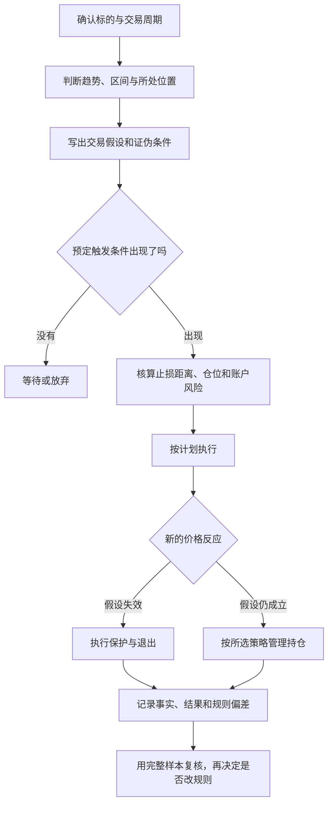

# Trade C读图与复盘术语速查

这是阅读本专题的辅助说明，**不是作者对每个词的统一正式定义**。同一缩写可能被不同交易者用得不完全一样，应优先看原帖图表与上下文。

| 术语 | 在本专题中如何理解 | 最常见误读 |
|---|---|---|
| HTF／LTF | 较高／较低时间周期，是相对关系 | 把某个周期永远当作HTF，不说明与谁比较 |
| HH／HL | 更高高点／更高低点 | 只找到一个小波峰，就认定大周期已经反转 |
| LH／LL | 更低高点／更低低点 | 忽略波峰波谷所处的周期和结构层级 |
| N字结构 | 作者对“推动—回调—再推动”的形象描述 | 以为所有长得像字母N的图形都一样 |
| MSS | 市场结构变化的缩写；作者常用关键摆动点被突破来描述 | 把一次插针突破当作最终确认 |
| 支阻互换 | 过去的支撑或阻力，突破后可能发挥相反作用 | 把“可能形成作用”当作价格必定反应 |
| 推动腿／修正腿 | 沿主要方向展开的运动／逆向或横向整理 | 把任何回调都视为趋势终结 |
| 跟随／追随 | 事件发生后，价格有无继续朝该方向发展 | 只看信号K，不看后续反应 |
| 区间 | 作者判断买卖力量相对平衡的价格范围 | 以为边界永久有效、不会突破 |
| 假突破 | 越过边界后未能维持，重新回到原范围的情形 | 事前认定每次突破都是假的 |
| 证伪位 | 使本次交易假设不再成立的参考位置 | 把它改成“我最多愿意再等等的位置” |
| ATR | 衡量一段时期真实波幅的指标；常用于波动和止损参考 | 当作方向预测，或把ATR数值等同账户亏损 |
| R | 风险记账单位；本文明确指出作者有时口径不一致 | 把不同金额基准的R直接混加 |
| MM | 测量运动目标：以选定的一段价格距离推算参考目标 | 把测量目标当成必达价格 |
| FVG | 常指三根K线之间的不平衡／缺口型区域，需看具体画法 | 认为所有FVG必须回补，或与所有“缺口”完全同义 |
| Stop order | 价格触及触发水平后激活的订单；作者也用它描述突破入场 | 把“stop”一律理解为止损，而不看订单方向与用途 |
| Limit order | 按指定限价或更优价格成交的订单 | 以为挂到好位置就保证成交 |
| 做多／做空 | 分别押注价格上涨／下跌的方向性仓位 | 不区分持仓方向、实际执行状态与观点 |
| 左侧／右侧 | 相对作者所等确认而言，提前试探／确认后参与 | 以为左侧一定危险、右侧一定安全 |
| 止盈／移动止损 | 到预定条件退出获利／随计划调整保护位置 | 把移动保护当成随手干预订单 |
| 均值回归 | 押注偏离后向某个均值或均衡范围返回的思路 | 单凭固定2R止盈，就认定是均值回归 |
| 右尾 | 收益分布中少数较大的正收益 | 以为任何持有更久的交易都会产生右尾 |
| OI | 未平仓合约量，反映未平仓头寸总量 | 只凭OI变化就断定所有新头寸的方向和动机 |

## 把一条图表意见读成可复核的过程

此图是编辑整理的学习顺序。它不代表只要完成这些步骤就会盈利，也没有替任何标的生成当下买卖信号。

## 最容易混淆的三组概念

**价格跌不下去，与价格已经开始上涨。** 前者是原方向延续能力的观察，后者还需要新的上涨证据。对应 [[01-Trade C交易思路详解]] 中WLD案例。

**错过盈利，与实际亏损。** 没成交、提前卖后上涨，都可能让人难受，但不能和账户发生的实际损失直接相加。

**执行规则，与证明规则有效。** 执行一致性能让记录有可比性；策略是否有优势，仍需在计入成本的完整样本中检验。

关于期货订单、合约与仓位用语，可参照 [CME术语表](https://www.cmegroup.com/education/glossary)；仓位与止损的关系见 [CME仓位说明](https://www.cmegroup.com/education/courses/trade-and-risk-management/proper-position-size)。
