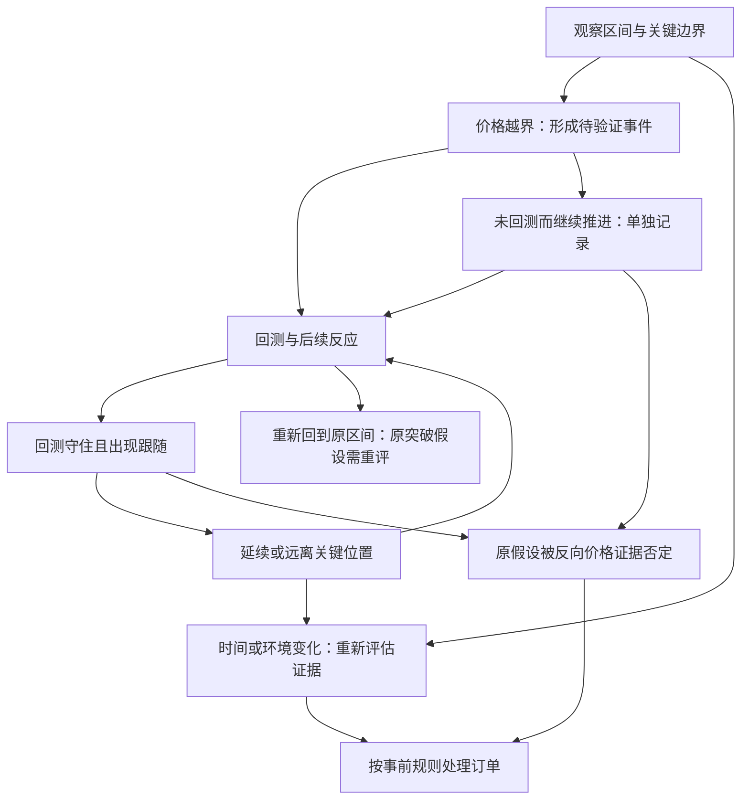

# MSKR第三方推理与交易框架对照

> [!important] 来源与使用方式
> 本文整合用户提供的第三方推理稿，原稿见 [[07-MSKR第三方推理原稿]]。未收到稿中提到的公开截图、付费指南或指标源码；本次在已归档283帖中未检出MSKR名称，补充网页检索也未取得能核对其具体规则的一手材料。**因此下文是理解交易决策的辅助框架，不是已验证的MSKR产品说明或参数表。**

## 一、这份推理最有价值的地方

原有 [[01-Trade C交易思路详解]] 按背景、结构、入场、风险和退出展开。这份稿子补充了一个更容易执行的阅读方式：**不只给价格贴“多、空”标签，还记录当前判断处在什么阶段、凭什么继续有效、什么发生后必须重新评估。**

可以把每次观察记成五项：

| 项目 | 需要写下什么 | 学习价值 |
|---|---|---|
| 当前状态 | 区间内、越界待确认、回测中、延续、原假设失效等 | 不把不同阶段的图混作同一种机会 |
| 支持证据 | 已发生的突破、回收、跟随、回测表现 | 将已见事实与期待分开 |
| 状态转换条件 | 哪个新事件允许更新判断 | 减少盘中临时改口 |
| 当前约束 | 哪种动作不符合这一笔的计划 | 防止形态漂亮就忽略背景 |
| 重评条件 | 价格、时间或环境变化到什么程度要重新看 | 防止旧计划无限有效 |

这是对第三方思路的编辑归纳。它与作者反复强调的“位置—事件—反应—后续推动”相容，但不能据此认定作者已按这五项实现指标代码。

## 二、与公开原帖能对上的部分

| 第三方稿的主线 | 已归档原帖支持到什么程度 | 不能进一步推导什么 |
|---|---|---|
| 多周期分工，避免级别错配 | 8月15日LDO复盘明确反思周期过小及主观方向；黄金与LDO需结合高周期背景 | 不能证明所有策略都禁止逆大周期的小周期交易 |
| 穿越边界不等于确认接受 | 8月24日复盘强调事件后反应与后续跟随 | 不能证明指标使用某个精确ATR阈值或收盘根数 |
| 先有背景，再有触发 | 8月11日长帖区分回调Setup与重新启动Trigger | 不能把所有限价试探都判为违反作者规则 |
| 旧持仓理由失效后要调整 | 9月SOL复盘承认坚持主观剧本、忽略结构变化 | 不等于软件状态超时就必须平仓 |
| 趋势、区间和转换阶段区别处理 | 8月11日讨论不清晰环境下按震荡标准降低目标 | 不等于一个含糊信号出现后整天禁止交易 |

对照来源：[LDO](https://x.com/TradercBTC/status/2088595421597978948)、[黄金](https://x.com/TradercBTC/status/2091716251999690863)、[WLD](https://x.com/TradercBTC/status/2091718714534359281)、[Setup与Trigger](https://x.com/TradercBTC/status/2087013094124101754)、[SOL执行反思](https://x.com/TradercBTC/status/2096187250094850277)、[转换阶段](https://x.com/TradercBTC/status/2087109654317052147)。

## 三、把“生命周期”作为复盘工具

以下状态图是**第三方推理经过编辑修正后的概念图**，不代表已还原指标的全部状态、路径或源码。

### 应怎样读这张图

**候选与确认分开。** 首次越界是一件发生过的事；后续能否维持，是另一个需要观察的问题。不能仅凭“候选”这个名称就推导成功概率。

**回测确认与未回测推进分开。** 两者的已知证据不同；有没有入场价值仍取决于采用的策略、剩余空间与风险，不能普遍规定“不回踩就不能交易”。

**失效与超时分开。** 失效通常指价格证据不再支持原假设；超时可能只是模型主动限制旧信息的有效期。没有完整规则时，不能把超时翻译为反转、强制清仓或自动减仓。

**状态描述与订单动作分开。** “已经延续”不自动等于加仓，“扩张”不自动等于平仓。订单动作还需要风险预算、执行周期、已有仓位和失效条件。

## 四、把多周期关系写成问题，而非机械口令

第三方稿提出冲突、共振、前方障碍、双向压缩等分类，很适合帮助初学者发现被忽略的信息：

- **角色冲突：** 小周期看似支撑，但高周期正处阻力附近。这是提醒重新核对交易层级；是否不参与，应由所选策略决定。
- **位置重合：** 多个周期的参考位相近，可以集中观察反应。但这些周期来自同一价格序列，不能把它们当作互相独立的多份证据，直接推导胜率更高。
- **前方障碍：** 即使方向假设成立，到下一关键位的空间可能不足。应比较目标距离、止损距离和成本。
- **双向压缩：** 上下空间都小，应警惕反复触发。它是需要评估的环境，不是“所有区间交易无效”的证明。

原稿“HTF决定方向，LTF绝不改方向”的表述过强。作者1月19日至20日记录过不同周期的区间多单，1月26日也有小仓左侧试探。更准确的归纳是：**一笔交易应先明确自己的决策周期，不能为了持仓盈亏临时换周期。** [区间交易](https://x.com/TradercBTC/status/2013419838295646497)、[左侧试探](https://x.com/TradercBTC/status/2015629441050022147)。

## 五、原稿中需要修正或保留为假说的表述

| 原稿表述 | 整合后的处理 |
|---|---|
| 级别错配占散户结构性亏损的大头 | 缺统计来源，不保留为比例或主要成因结论 |
| 假跌破说明大资金完成买入、所有止损被触发 | 仅是可能的参与者解释；K线本身不能确认主体、订单规模或动机 |
| 假突破后边界一定更硬、质量最高 | 只能说明这次越界未维持；后续强弱需要重新观察，不能保证持续增强 |
| 七种身份是可靠性阶梯，可靠性只升不降 | 可用作分类，不能当作已验证概率排名；时间与新证据都可能改变评价 |
| 确认接受是最高置信度、最好的进场结构 | 应说明“在该推理框架中优先考虑”，没有独立统计支持最高胜率或最优收益 |
| 突破后回踩做多，目标看箱体另一侧 | 方向含糊：若向上突破后在上沿外做多，旧箱体下沿通常在下方，不能直接当上方盈利目标；必须明确突破方向和目标所指 |
| 面板一次不要参与，就当日默认空仓 | 将某一状态约束扩大成全天限制，缺少依据；应明确约束适用的标的、周期与有效期 |
| 所有判断以收盘为准 | 可作为第三方描述，未核实指标实现；作者历史交易包含限价试探，不能推广为全部交易规则 |

## 六、参数与产品细节：只保留为待核验清单

**以下数字来自用户提供的第三方稿，未核实为MSKR默认值，不应直接据此配置交易。**

| 稿中项目 | 稿中数值／描述 | 尚缺什么 |
|---|---|---|
| 突破候选 | 0.10 ATR | 对应哪个周期的ATR、长度、边界与版本 |
| 假突破回收 | 0.25 ATR＋2根 | 收盘条件、计数周期、连续性及重置规则 |
| 接受与失效 | 接受1根，反向穿越2根 | 完整定义、测试开始与终止条件 |
| 扩张 | 1.50 ATR | 距哪个边界、用何时的ATR，是否动态变化 |
| 超时 | 12／30／30／60根 | 分别如何计时，状态切换是否重置 |
| 展示结束 | 6根大周期K线 | 是否仅影响显示，是否改变逻辑状态 |
| 短线障碍 | 0.50 ATR | 距离计算方式与适用状态 |
| 产品展示 | 8行变12行、近30种报警、指南约18056字 | 对应版本与作者一手说明 |

原稿自己说明部分剧本与组合是“对称推出”。因此六剧本、六组合、七级可靠性排序，应作为第三方组织材料的方法，不能在总结里写成作者逐项公开确认的正式功能列表。

## 七、用于学习的记录模板

复盘一张图时，可以填写以下内容；这是观察与回测模板，不是已经验证可实盘执行的MSKR策略：

1. 我使用什么周期定义本次交易？大周期在哪个位置？
2. 价格已经发生了什么？我尚在等待什么？
3. 当前是区间内、越界待验证、回测，还是已有跟随？
4. 哪个条件会否定这笔假设？这与指标“超时”是否是同一回事？
5. 当前有哪些动作不符合事前计划？限制适用到何时？
6. 到下个参考位还有多少空间？风险金额与仓位是否另行计算？
7. 后续结果是什么？当时依据与事后解释是否分开记录？

这份稿子对原总结的有效补充，是把零散的读图判断组织为**状态、证据、转换、约束、重评**的过程；它没有补齐未经公开核验的产品细节，也不能替代完整策略检验。
