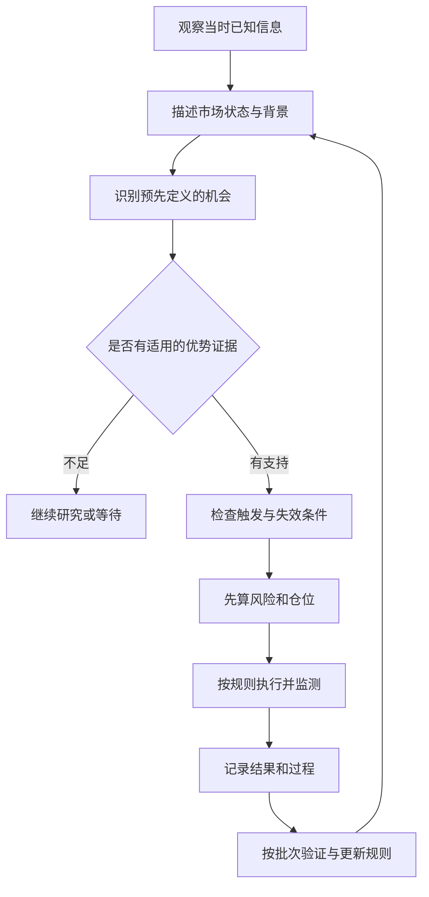

# Trade C新手教程：从看不懂术语，到能说清每笔决策

这份教程最重要的一句话可以翻译成：**先看市场处在什么情况，再问自己的方法在这种情况下有没有证据支持，最后决定愿意承担多少风险。**会看K线只是第一步。

用户将这份PDF归属于Trade C。本库按用户提供的归属收录；文件正文题名为《技术流交易员完整知识地图》，没有据此确认公开发布日期或版本号。本次整理日期为2026-10-22。

## 资料与精读入口

| 资料 | 内容与用途 |
|---|---|
| [[交易技术分析/Trade C/新手教程精读/原始资料/新手教程.pdf|原始PDF]] | 24页原件，完整复制，未改内容 |
| [[交易技术分析/Trade C/新手教程精读/03-原文逐页转录|原文逐页转录]] | 24页可搜索文字，原版布局以PDF为准 |
| [[交易技术分析/Trade C/新手教程精读/01-第一篇逐节精读-交易与职业地图|第一篇逐节精读]] | 全部32节，原文对照＋白话＋例子/误区＋练习 |
| [[交易技术分析/Trade C/新手教程精读/02-第二篇逐节精读-47个核心概念|第二篇逐节精读]] | 全部47节，从价格、趋势一路到复利与职业流程 |
| [[交易技术分析/Trade C/新手教程精读/04-公式逐项翻译与手算册|公式手算册]] | 符号字典、仓位、1R、期望、回撤、复利及原版公式页 |
| [[交易技术分析/Trade C/新手教程精读/05-练习题与复盘模板|练习与模板]] | 20题附答案、完整纸面案例、可复制日志 |
| [[交易技术分析/Trade C/新手教程精读/06-术语与易混概念速查|术语速查]] | 英文翻译与常见概念区别 |

## 推荐先这样读

第一次不要强迫自己背79节。先用以下顺序建立骨架，再回原顺序逐节精读；时间只是学习安排示例，不是掌握保证。

1. **先懂流程（约20分钟）：**第一篇第1、11、23、32节，能区分背景、机会、触发、入场。
2. **再懂如何亏、亏多少（约30分钟）：**第二篇第24—28节＋公式册第5—7部分，亲手算预算、手数、1R。
3. **再懂为什么不能只看胜率（约30分钟）：**第一篇第16—20节＋公式册第4部分，比较两个盈亏分布。
4. **再懂账户为什么会撑不住（约30分钟）：**第二篇第32—36节＋公式册第8—10部分，算回撤和逐笔复利。
5. **最后回到读图和执行：**第二篇第1—23节、第37—47节；每学一个词，配一条可观察规则和失败标准。
6. **做完20题，再用纸面案例走流程。**答错题回到对应章节，不用靠真实亏钱来检验自己是否会算。

这个流程是学习框架，本PDF没有给出足以直接验证某套黄金策略的完整数据、样本外结果、固定触发参数和退出规则。

## 六个最值得先记住的区别

- **看涨 ≠ 现在买。**方向、时机、价格和风险分别判断。
- **形态 ≠ 优势。**形态是可描述条件，优势还要看净结果证据。
- **止损价 ≠ 保证亏损上限。**预算与真实成交之间可能存在偏差。
- **胜率 ≠ 赚钱能力。**还要看平均盈亏与成本。
- **赚了 ≠ 决策正确。**先看当时是否合规，另查规则是否有证据。
- **正期望 ≠ 任意仓位都能赚钱。**仓位会改变回撤和复利生存条件。

## 对原文的补充辨析

原文整体强调“可观察、可量化、可证伪”，有助于整理学习语言；以下地方需要额外说明，已在对应精读与公式册展开：

1. 动能一处用乘号、一处用加号，均当维度示意，不当严格算法。
2. 趋势的“上涨概率更大”不等价于“平均收益为正”，还取决于涨跌幅度。
3. R有收益变量与风险单位等不同语境，计算前必须确定单位。
4. “Loss≤预算”是计划目标，订单成交可能超出；保证金也不是最大亏损。
5. `ΔEquity=Edge×Exposure×Execution−Costs`和六项乘法是概念模型，真正记账使用收支等式。
6. 复利公式需要说明风险比例、成本、外部收支与正增长因子；净值函数f与风险比例f不是同一种符号用法。
7. “所有盈亏的原因都能从K线还原”并非本文允许的结论；订单聚集与参与者动机是需要证据的假设。
8. 本文提到BAC但未展开模型，不补造缩写；提到破产风险但没给充分参数，不编精确概率。
9. 最后一条流程链把Trade排在Risk前面，不应理解成下单后才考虑风险；精读把事前预算与事中监测分开。
10. 原件包含术语与方法论，没有单凭这些文字就确认的稳定盈利系统。

## 如何判断自己开始掌握了

能够用自己的话区分Context/Setup/Trigger；能够算出某个假设交易的每手风险和允许数量；能够解释一次正常亏损与一次违规盈利；能够承认尚未验证的优势；能够从峰值计算回撤。能完成这些，比背出所有英文更重要。

原文、补充讲解与官方查证资料在文件中分层标注。学习新增内容不计入每日X原帖数量，既有公开帖归档未合并或删除。
